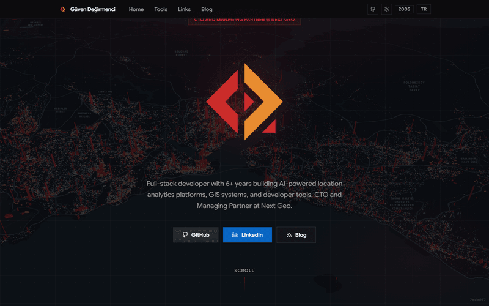
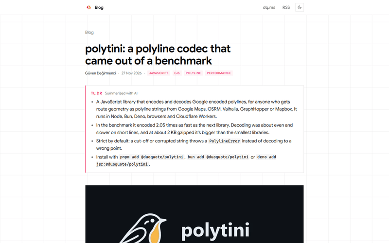

# dq.ms

My personal site, [dq.ms](https://dq.ms), and my blog, [blog.dq.ms](https://blog.dq.ms). Both are Astro projects in this repo and both are static.

<p>
  
  
</p>

## What's here

| Folder | What it is |
|---|---|
| `src/` | dq.ms: the home page, `/links` and the tools, in English and Turkish (`/tr/`). The translations are a plain dictionary in `src/lib/i18n.ts`, no i18n library. |
| `blog/` | blog.dq.ms. Its own Astro project, sharing `node_modules` and the design tokens in `src/styles/theme.css`. Posts are Markdown in `blog/posts/`. |
| `wasm/` | Two Rust crates compiled to WebAssembly, for the Geo Viewer and the Image Vectorizer. The built `pkg/` folders are committed. |
| `archive/` | The previous version of the site (Vite and MUI). Nothing builds or deploys it. |

The stack is Astro 5, React 19 islands, Tailwind CSS 4 and TypeScript. The tools all run in the browser:

| Tool | Does |
|---|---|
| [H3 Explorer](https://dq.ms/tools/h3-explorer/) | Shows any H3 cell on a Leaflet map |
| [Video Converter](https://dq.ms/tools/converter/) | Converts video and audio with ffmpeg.wasm |
| [Geo Viewer](https://dq.ms/tools/geo-viewer/) | GeoJSON, Shapefile and KML on MapLibre with deck.gl |
| [Image Vectorizer](https://dq.ms/tools/imvector/) | Raster images to SVG, with optional AI upscaling and denoising in onnxruntime-web |
| [GIF Optimizer](https://dq.ms/tools/gif-optimizer/) | Crops, resizes and compresses GIFs |
| [Image Compress](https://dq.ms/tools/image-compress/) | 13 presets side by side: MozJPEG, WebP, AVIF, JXL and PNG |
| [imdotter](https://dq.ms/imdotter/) | Turns an image into a risograph print |

There's also a "2005" button in the header that reskins the whole site as a GeoCities page.

## Run it

```bash
bun install
bun run dev                       # dq.ms on http://localhost:4321
bun run dev:blog                  # the blog, drafts included
bun run build                     # dq.ms to dist/
bun run build:blog                # the blog to blog/dist, drafts left out
BLOG_DRAFTS=1 bun run build:blog  # the blog with drafts, for checking them
```

`bun run build:wasm` rebuilds the two crates. You only need it after changing them, and it needs Rust with the `wasm32-unknown-unknown` target and `wasm-bindgen` (it's a PowerShell script).

## Deploy

| Site | Runs on | Deploys |
|---|---|---|
| dq.ms | Cloudflare Pages, project `duo` | On every push to `main` |
| blog.dq.ms | Cloudflare Worker `duo-blog`, static assets from `blog/dist` | `bun run deploy:blog`, unless Workers Builds is connected |
| guvendegirmenci.com | | 301 to dq.ms |

`dq.ms/blog` sends a 301 to blog.dq.ms (`public/_redirects`). The blog's Worker, `blog/worker.js`, is small: it moves http and other hostnames to https://blog.dq.ms, sends `/post/` and `/post.html` to `/post`, and returns a post's Markdown when the request asks for `text/markdown`. With Workers Builds, use `bun run build:blog` as the build command and `node blog/scripts/deploy.mjs` as the deploy command.

Search and AI readers:

- Both sites have a sitemap, Open Graph tags, JSON-LD, and an `llms.txt` and `llms-full.txt` built from the same text as the pages. dq.ms also has hreflang for English and Turkish.
- Both `robots.txt` files let search engines and AI search bots in, with a Content-Signal line for search and AI answers.
- Each post is also at `/<slug>.md` as plain Markdown.
- `bun run deploy:blog` sends the new and changed URLs to IndexNow (Bing, Yandex and others). The key file is in `blog/public/`.

## Write a post

A post is a Markdown file in `blog/posts/`, and its file or folder name is the URL:

```
blog/posts/my-post.md         -> blog.dq.ms/my-post
blog/posts/my-post/index.md   -> blog.dq.ms/my-post, with images next to it
```

```yaml
---
title: My post                  # required
date: 2026-11-26                # required
description: One or two lines.  # meta description; falls back to the summary, then the first paragraph
summary:                        # the TL;DR box: 1 or 2 sentences, or 2 to 4 points
  - "What it is, in one line."
  - "The main result, with its number."
summaryBy: ai                   # the default, shown as "Summarized with AI"; use author if you wrote it
updated: 2026-12-01             # optional, also accepted as lastmod
tags: [astro, cloudflare]
cover: ./cover.jpg              # also the og:image
coverAlt: What the cover shows
draft: true                     # kept out of the build
---
```

The summary shows in a box under the title. It also goes into the post's Markdown copy, `llms.txt` and the JSON-LD. `bun run summarize <slug>` prints a prompt to give Claude or another agent, and you paste its answer into the front matter. The build itself never calls an AI service. It does warn when a published post has no summary.

Start sections at `##`, since the title is the page's only `h1`. Link images relatively, like ``: the build resizes them, converts them to WebP and warns when the alt text is missing. For a chart with a dark version, put both on one line, ` `, and the page shows the one that matches the theme.

`blog/posts/markdown-reference/index.md` is a draft that uses every supported feature. Copy it to start a new post.
