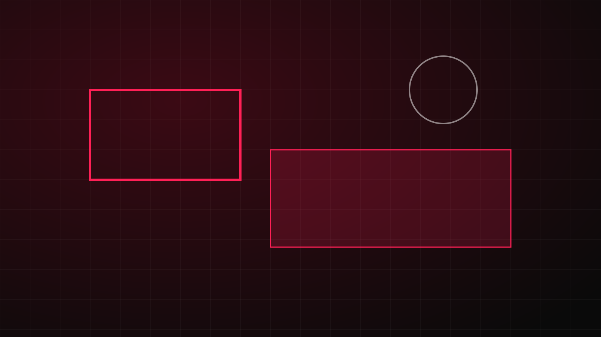

This post is a test page for the blog itself. It stays a draft, so it only shows up in `bun run dev:blog` or in a build with `BLOG_DRAFTS=1`. Copy it when starting a new post.

The box above is the post's `summary` from the front matter: 1 or 2 sentences, or 2 to 4 bullet points, with `inline code` allowed. It's labelled "Summarized with AI" unless the front matter says `summaryBy: author`, like this one. It's also used as the meta description when `description` is empty, and it goes into the post's Markdown copy and `llms.txt`. A published post without one gets a build warning. `bun run summarize <slug>` prints a prompt for an agent to write it. The build itself never calls an AI service.

## Text

Paragraphs are plain text with **bold**, *italic*, ~~strikethrough~~ and `inline code`. Links look like [the duo-web repo](https://github.com/Duoquote/duo-web), and bare URLs like https://dq.ms turn into links too.

> A blockquote. Good for quoting docs or an error message.

Footnotes go at the bottom of the post.[^1] They are numbered in order of use.[^why]

## Lists

- An item
- Another item
  - Nested item
- [x] A finished task
- [ ] An open task

1. First step
2. Second step

## Code

```ts
// Highlighted at build time with Shiki, so no JavaScript runs in the browser for it.
export function slugify(name: string) {
  return name.toLowerCase().replace(/[^a-z0-9]+/g, "-");
}
```

```bash
bun run build:blog
```

## Tables

| Front matter | Required | What it does |
| --- | :---: | --- |
| `title` | yes | Page title and h1 |
| `date` | yes | Publish date |
| `description` | no | Meta description. Falls back to the first paragraph |
| `updated` | no | Last edit, used for `dateModified` and the sitemap |
| `tags` | no | Shown on the post, also `article:tag` |
| `cover` | no | Image next to the post, also the `og:image` |
| `draft` | no | `true` keeps the post out of the build |

## Images

Put images next to the post and link them relatively. They get resized into several widths, converted to WebP, and given a width and height. The text in quotes becomes the caption.



For an image with a dark-theme version, put both on one line and end the second file name in `-dark`, like ` `. They become one figure, and the page shows the one that matches the theme. The Markdown copy keeps only the first.

### Smaller heading

Headings get an anchor link that shows on hover, so a section can be linked directly.

[^1]: This is the first footnote.
[^why]: Footnote labels can be words. They still render as numbers.
