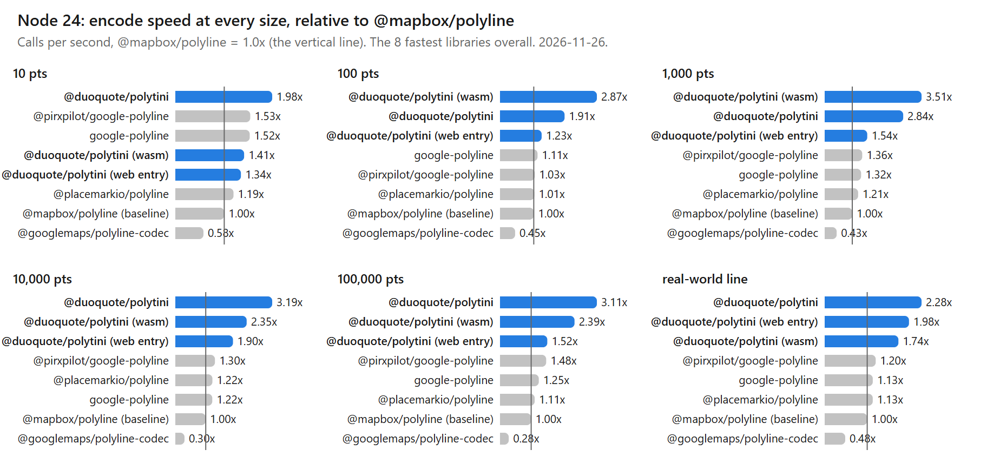

polytini is a JavaScript library that encodes and decodes Google encoded polylines. Those are the short strings like `_p~iF~ps|U_ulLnnqC` that Google Maps, OSRM, Valhalla, GraphHopper and Mapbox return for route geometry. It's on npm and JSR as `@duoquote/polytini`.

## Where it came from

In September 2021 I put up [polyline-benchmark](https://github.com/Duoquote/polyline-benchmark): a small script that decoded 1000 real-world lines a thousand times with five libraries, on a Ryzen 5 3600. Four of them took 8 to 25 seconds, and `decode-google-map-polyline` took 2.45 minutes. The README ended with a TODO list: benchmark encoding too, compare conversion to GeoJSON, and test more line lengths. Then it sat there for five years.

TODO(user): why you wrote the 2021 benchmark, and why you picked it up again in November 2026.

This November I rebuilt it. It now checks every library against a slow reference codec before timing anything, then runs each one on Bun, Node 22 to 26, Deno and Chrome. I wrote polytini while doing that, and it's in the same tables, so read its rows knowing who made it.

## What it's good at, and where it isn't

These numbers are from the benchmark's November 2026 run with polytini 0.1.0, on a Ryzen 7 5800X. A cell moved about 30% between rounds, so I count smaller gaps as even.

- Encoding is where it clearly wins. Across all runtimes and line lengths it was 2.05 times as fast as the next library, `google-polyline` (geometric mean). From 1,000 points up, single cells ranged from 1.6 to 7.7 times the next library.
- Decoding is about even. polytini came first on long lines and on the real-world lines, but only by 1.14x and 1.22x, which is inside the noise. On short lines (10 and 100 points) it was slower than the fastest other library in 14 of 16 cells, by 5 to 36%. In Chrome, `@googlemaps/polyline-codec` also decoded long lines faster.
- It's bigger. The default entry is about 2 KB gzipped, against 551 bytes for `google-polyline` and 568 for `@googlemaps/polyline-codec`. The extra goes into the error checks, an exact path for precision 7 and up, and more input shapes.




Every runtime, every table and the memory numbers are in the [results](https://github.com/Duoquote/polyline-benchmark/blob/main/docs/results.md).

## Strict by default

A cut-off polyline still looks like a polyline. It's just characters, so a string that hit a URL length limit or a short database column still decodes. Here's what the libraries return for `_p~iF~ps|U_ulLnnq`, which is Google's documented example cut off in the middle of the second point:

- `@mapbox/polyline` gives `[40.7, -120.29464]` as the second point. The real one is `[40.7, -120.95]`, about 55 km away.
- `@googlemaps/polyline-codec` gives `[40.7, -120.45848]`.
- `google-polyline` drops the point, and `polyline-encoded` returns `null` for the longitude.
- polytini throws a `PolylineError` with the code `truncated` at index 17.

On a map, a wrong point looks like any other point, so it's easy to miss. polytini throws on invalid characters, cut-off strings and NaN coordinates, with a `code` and an `index`. If you really want lenient parsing, `strict: false` turns it off.

I made it the default because it's cheap. On 10-point lines the checks measured 0 to 4%, and I couldn't separate them from the noise on longer ones. The decoder ORs every character code into one integer and checks it once at the end.

## A build per runtime

The default import picks a build through package.json export conditions: `node`, `bun`, `deno`, `browser` and `workerd`. Each build only has its own code where it measured faster than the portable core on that runtime:

- Node and Bun write the encoded bytes into a reused `Buffer` and turn them into a string with one `latin1Slice` call. On Node 24 that was 109 against 66 million points per second, and on Bun 2.3 times the core.
- Under Deno, `node:buffer` was slower than the core, so the Deno build uses `TextEncoder.encodeInto` and `TextDecoder('latin1')` instead. Encoding was 1.5 times faster.
- In Chrome, long lines encode through `TextDecoder`, 1.6 times faster. Decoding stays on the plain `charCodeAt` loop, because copying into bytes first made it slower there.

Most of the gain is in encoding, where building the string piece by piece was the slow part. Decoding gained much less: 1 to 14% on most Node versions and about 6% on Deno.

## What WASM did and didn't buy

There's an opt-in WebAssembly build at `@duoquote/polytini/wasm`, a hand-written WAT module that assembles to 906 bytes.

- For `[lat, lng]` arrays it doesn't help. Building the arrays is most of the work, and reading numbers out of WASM memory only added to it, so the WASM entry hands those calls to the JavaScript core.
- It does help with typed arrays on long lines, and with many lines in one call. `decodeMany` decodes all 1000 real-world lines in one call into deck.gl's binary layout. That was 1.36 to 2.70 times as fast as the JavaScript way to the same output on Bun, Node and Deno. In Chrome it was 0.93, so a bit slower.
- `encodeMany` lost everywhere, at 0.61 to 0.79. Making one string per line is the expensive part, and a batch doesn't make that cheaper.
- A Rust version that reads 8 bytes at a time was 2.7 KB and 10 to 40% slower than the plain byte loop. Each value starts where the last one ended, so there's little to do in parallel.

## Cloudflare Workers

The default import works on Workers as is. A `workerd` export condition gives Workers the Deno build, which decoded faster in workerd than the browser build Wrangler picked before. CI runs the tests in workerd on every push.

`/wasm` needs one extra step there, because Workers don't compile WebAssembly from bytes at runtime. Import the `.wasm` file and pass it in:

```js
import { init, decodeMany } from '@duoquote/polytini/wasm';
import wasm from '@duoquote/polytini/polytini.wasm';

await init(wasm);
```

I've only measured Workers locally in workerd, not on Cloudflare's servers. Encoding was about the same as Node. Decoding was close to Node in some runs and up to 1.8 times slower in others, with nothing changed in between. I haven't found out why yet.

## Integrations

Each one is its own subpath, so it adds nothing to the main entry. None of them import their map library: you pass it in, or hand their output to it.

- `/presets`: options for OSRM, Valhalla, GraphHopper, Mapbox, Strava and others, with the right precision and coordinate order
- `/leaflet`: `L.Polyline.fromEncoded` and `toEncoded`, for Leaflet 1.9 and 2
- `/turf`: GeoJSON Features in Turf's shape, and any GeoJSON line back to strings
- `/google`: drop-in `decodePath` and `encodePath` for the Maps JavaScript API
- `/openlayers`: a drop-in `ol/format/Polyline` that doesn't overwrite your geometry when it writes
- `/maplibre` and `/mapbox`: GeoJSON sources and line layers
- `/deckgl`: binary paths for `PathLayer` and `TripsLayer`, with no array per point
- `/flexible`: HERE's Flexible Polyline, a drop-in for `@here/flexpolyline` that was 24 times as fast in the benchmark

There's also a CLI: `npx @duoquote/polytini decode '<polyline>'`.

## Try it

```sh
npm install @duoquote/polytini
deno add jsr:@duoquote/polytini
```

```js
import { encode, decode } from '@duoquote/polytini';
import { osrm6 } from '@duoquote/polytini/presets';

encode([[38.5, -120.2], [40.7, -120.95]]); // '_p~iF~ps|U_ulLnnqC'
decode('_p~iF~ps|U_ulLnnqC');              // [[38.5, -120.2], [40.7, -120.95]]
decode(route.geometry, osrm6);             // OSRM polyline6, as [lng, lat]
```

One thing to watch: the precision isn't stored in the string. A `polyline6` string decoded at precision 5 gives coordinates ten times too big, with no error. That's what the presets are for.

The code is on [GitHub](https://github.com/Duoquote/polytini), the package on [npm](https://www.npmjs.com/package/@duoquote/polytini) and [JSR](https://jsr.io/@duoquote/polytini), and every table and chart is in [polyline-benchmark](https://github.com/Duoquote/polyline-benchmark).

TODO(user): optional, one or two lines on what's next or what feedback you want. Delete this line if there's nothing to add.
